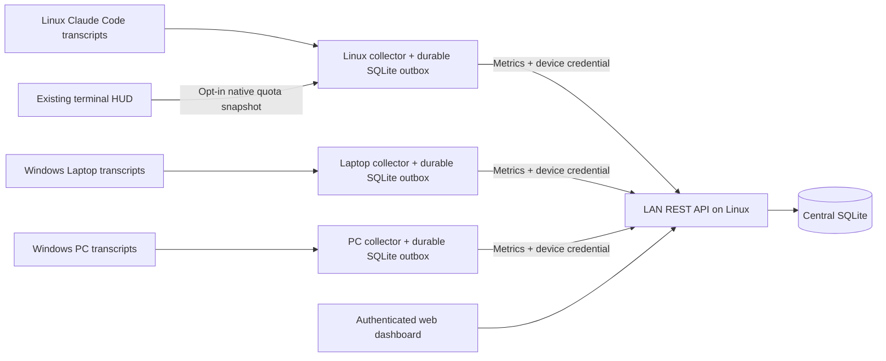

# Claude HUD multi-device monitoring

The monitoring extension runs beside the existing terminal HUD. The HUD's
installation, update flow, configuration, sandbox, context, tool/agent/task/todo
displays and rate-limit display remain independent. Installing monitoring does
not replace Claude Code hooks or its status-line command.

## What it measures

The collector reads local Claude Code JSONL under `~/.claude/projects` (Windows:
`%USERPROFILE%\.claude\projects`). `$CLAUDE_CONFIG_DIR/projects` is used when that
environment variable is set at configuration generation. `projects` can be
overridden explicitly. Nested subagent transcripts are included under the parent
session. Input, output, cache creation, and cache read tokens are separate;
**total recorded tokens** is their sum. Cache creation's per-TTL breakdown is a
fallback when its total field is absent, never added on top of that total.

These numbers measure recorded activity. They do **not** determine Claude Pro
allowance, money owed, or a device's share of subscription quota. The account's
five-hour and seven-day quota observations are displayed separately, only from
Claude Code's supported status-line fields. No private API, cookie scraping,
OAuth token, API key, email, or account credential collection is used.

Features include five-hour/24-hour/seven-day/30-day/all-recorded windows, device,
model, project and session aggregates, hourly/daily charts, independent heartbeat,
offline queue/retries, device enrollment/revocation, synchronization diagnostics,
and filtered CSV/JSON exports. The dashboard refreshes every ten seconds; agents
collect and upload every thirty seconds by default.

## Architecture



The server and collector run as separate processes. Node's built-in SQLite
provides WAL, transactional migrations, durable ingestion, and prepared queries.
`monitor/store.ts` contains the central storage adapter; a future PostgreSQL
adapter can keep the same protocol. Nothing is imported into the caged HUD.
See [the audit/design](monitoring-design.md) and [HTTP reference](monitoring-api.md).
The [verification report](monitoring-validation.md) records completed checks and
the hardware checks still needed before relying on a deployment.

## Requirements

- Node.js **22.18+**, with its built-in SQLite and TypeScript support. A current
  Node LTS is recommended. No Python, npm runtime package installation, bundler,
  cloud service or paid account beyond your existing subscription is needed.
- A stable checkout of this repository on every device. Do not copy runtime
  databases from one device to another.
- Linux: systemd user sessions for the automatic installer, a writable home,
  and `loginctl` lingering for startup before login after reboot.
- Windows: PowerShell and ScheduledTasks. If Node is absent, the installer uses
  `winget` to install Node LTS when available. Otherwise install Node first.
- macOS: the same collector CLI works with a user-managed supervisor. A macOS
  startup installer is not included.
- Claude Code transcripts are needed for activity. The existing HUD requires
  Claude Code 2.1.260+; native quota fields must be available in your client.

## Linux host: installation

From your existing checkout:

```bash
cd /home/skandha/Projects/claude-hud
node --version
bash scripts/monitor-linux.sh --host 0.0.0.0 --name Linux-Desktop
sudo loginctl enable-linger "$USER"
node monitor/cli.ts admin-token
```

The installer creates private configuration and databases in
`~/.claude-hud-monitor`, enrolls the host collector internally, and installs and
starts `claude-hud-monitor-server.service` and `claude-hud-monitor-agent.service`
in `~/.config/systemd/user`. Services restart on failure. Keep this checkout at
its current path; service commands use the absolute Node and checkout paths.
An existing config is retained on reinstall. `--dir /absolute/path` selects
another state directory; `--port 8787` selects another port when generating config.
Edit existing config rather than expecting repeated installer arguments to replace it.

`--host 0.0.0.0` explicitly opts into LAN access. The CLI's configuration default
is `127.0.0.1`; use that for a local-only dashboard, or specify the host's literal
private IPv4/IPv6 address for a single interface. Wildcard IPv6/public binding
is refused. The application rejects public source addresses regardless of binding.

Find the Linux machine's address using `hostname -I` or your router, then open
`http://LINUX_HOST_IP:8787`. For example, if its LAN address is `192.168.1.50`,
use `http://192.168.1.50:8787`. Reserve that IP in your router so agents keep a
stable destination, or configure a LAN DNS hostname in each agent's `server`.
Device identity does not depend on IP addresses.

The `admin-token` command explicitly prints your dashboard password. Run it in
a private terminal; do not paste its output into logs, issues, or shell arguments.
The dashboard holds it in tab memory, not localStorage or a cookie. Reloading or
locking the dashboard requires signing in again. Static login assets are public;
all analytics and management APIs require authorization.

Restrict your firewall to your **actual** LAN subnet. For example, with UFW and
an actual `192.168.1.0/24` network:

```bash
sudo ufw allow from 192.168.1.0/24 to any port 8787 proto tcp
```

Do not add router port forwarding or public ingress.

## Windows Laptop and Windows PC

On Linux, open **Management**, type `Windows-Laptop`, and create an enrollment.
Its one-use token expires after fifteen minutes. The pre-created device is
shown as **never connected** until registration succeeds.

On the laptop, clone this repository if needed, or use its existing checkout:

```powershell
git clone https://github.com/MadhavVN011/claude-hud.git
cd claude-hud
& .\scripts\monitor-windows.ps1 -Server 'http://LINUX_HOST_IP:8787' -Name 'Windows-Laptop'
```

Enter the enrollment token at the hidden Node prompt. If your execution policy
blocks this reviewed script, allow this invocation only:

```powershell
powershell.exe -NoProfile -ExecutionPolicy Bypass -File .\scripts\monitor-windows.ps1 -Server 'http://LINUX_HOST_IP:8787' -Name 'Windows-Laptop'
```

Use a **new** dashboard enrollment named `Windows-PC` on the second Windows
machine, and run the same installer with `-Name 'Windows-PC'`.

The dashboard enrollment name is authoritative. `-Name` supplies local setup
metadata; central names can be changed in Management without changing agent
configuration. The script protects the state directory with the current user's
ACL, creates `agent.json`, enrolls if needed, and registers the current user's
**Claude HUD Usage Collector** scheduled task. It starts at login, runs on
battery, retries after failures, and restarts after the next login following an
unexpected shutdown. It does not run before Windows login.

```powershell
Get-ScheduledTask -TaskName 'Claude HUD Usage Collector'
Start-ScheduledTask -TaskName 'Claude HUD Usage Collector'
Get-ScheduledTaskInfo -TaskName 'Claude HUD Usage Collector'
```

Default state directory: `$env:USERPROFILE\.claude-hud-monitor`. Use `-DataDir`
for another location. A prior configuration/identity is retained when rerunning
the installer. Enrollment requires connectivity to Linux; after enrollment,
collection works during central-server outages.

## Manual setup / another Linux or macOS collector

Server, in one terminal:

```bash
node monitor/cli.ts init-server --host 0.0.0.0
node monitor/cli.ts server
```

Collector, in another terminal, after creating its dashboard enrollment:

```bash
node monitor/cli.ts init-agent --server http://LINUX_HOST_IP:8787 --name Workstation
node monitor/cli.ts enroll
node monitor/cli.ts agent
```

Use `--dir` on **every** command if you chose a custom state directory, or
`--config /absolute/path/to/agent.json` when starting/enrolling the collector.
`node monitor/cli.ts once` scans and uploads one batch for diagnostics. A regular
collector drains up to twenty 500-event batches per upload cycle.

For another Linux computer with automatic startup:

```bash
bash scripts/monitor-linux.sh --agent-only --server http://LINUX_HOST_IP:8787 --name Workstation
sudo loginctl enable-linger "$USER"
```

## Shared Claude Pro quota: supported source only

[Anthropic documents](https://code.claude.com/docs/en/statusline#available-data)
`rate_limits.five_hour` and `rate_limits.seven_day`, each with `used_percentage`
and `resets_at`, in status-line stdin. These fields can be independently missing,
including before a subscriber's first API response or after a reset. They do
not exist for every authentication/provider mode.

The existing HUD already exports these native fields when
`display.externalUsageWritePath` is configured. On **one or more enrolled devices
running the HUD**, run:

```bash
node monitor/cli.ts enable-quota
```

This is an explicit opt-in change to the HUD configuration. It backs up the
existing config beside it, preserves its other fields, and sets a private
snapshot path matching that device's `agent.json`. It does not change
`statusLine`, install hooks or collect credentials. The snapshot directory must
exist. Windows accepts the same Node command; include `--dir` if customized.
Per-project `claude-hud.json` overrides can supersede this global setting; remove
or align an overriding `externalUsageWritePath` if the snapshot is missing.

Have an active Claude Code Pro session produce a response and allow a status-line
refresh. The collector uploads only the two quota windows and the snapshot's
timestamp. It does not transmit balance labels or any account metadata. The
server independently selects the freshest valid observation for each window,
never sums observations, and shows its reporting device and age. It assumes
enrolled devices use the same account; it cannot authenticate account identity
without collecting credentials, which it intentionally does not do.

`quotaFreshMs` defaults to five minutes. A stale observation, passed reset, or
missing window displays **Unavailable**, including its remaining percentage.
`updated_at` is when the HUD wrote an observation of stdin's native limits;
it does not independently fetch or verify fresh account state. An idle session
may carry an older native rate-limit observation. The UI therefore describes
these as status-line observations. Last successful quota upload and observation
timestamps are exposed separately. No background account API polling is done.

The activity dashboard's **last five hours** always means a rolling event-time
window. It is independent of the subscription reset window shown in quota.

## Configuration

All paths in configuration must be absolute and local to that machine. Unknown
configuration keys, public server bind IPs, invalid URLs and invalid intervals
are rejected. Restart the corresponding service after edits.

Server configuration (generated with a random token; keep that generated token):

```json
{
  "host": "127.0.0.1",
  "port": 8787,
  "database": "/home/YOUR_USER/.claude-hud-monitor/server.sqlite",
  "adminToken": "KEEP_THE_GENERATED_RANDOM_TOKEN_FROM_INIT",
  "offlineMs": 120000,
  "activeMs": 900000,
  "quotaFreshMs": 300000,
  "maxBodyBytes": 1048576,
  "requestsPerMinute": 240
}
```

Change `host` to the Linux LAN address or `0.0.0.0` for LAN access. Source IP
rate limits apply to all requests, including assets, per minute. Authentication
tokens must be 32–256 URL-safe characters. Administrator and agent credentials
are distinct. Device credentials are stored hashed centrally and privately in
the local SQLite spool. Enrollment credentials expire after fifteen minutes.

Agent configuration example (Windows backslashes are doubled in JSON):

```json
{
  "server": "http://192.168.1.50:8787",
  "name": "Windows-Laptop",
  "projects": "C:\\Users\\YOUR_USER\\.claude\\projects",
  "database": "C:\\Users\\YOUR_USER\\.claude-hud-monitor\\collector.sqlite",
  "syncMs": 30000,
  "heartbeatMs": 30000,
  "quotaPath": "C:\\Users\\YOUR_USER\\.claude-hud-monitor\\quota.json",
  "projectAliases": {}
}
```

Use your real server address and username. `name` is a local label; rename centrally
in Management. `projectAliases` maps the **full hashed project ID** from a JSON
export to a chosen safe display label. By default labels are `project-` followed
by a short hash. Raw project directory names and working paths are not sent.
Aliases apply to new or replayed records; to relabel retained local history,
stop the collector and back up its spool, then remove only its `files` checkpoints
using SQLite before rescanning existing transcripts. Existing event IDs remain
idempotent. Never delete the outbox/identity to change a label.

`offlineMs` should exceed `heartbeatMs` plus reasonable network delay. Active
sessions are sessions with measured assistant usage in the last `activeMs` on
devices whose heartbeat is current and credentials are valid. This is an
activity inference, not a running-process count. Claude availability checks for
an executable on absolute PATH entries or standard user installation paths without
executing it. Data-directory presence is reported separately. Neither implies
that a Claude process is running, and the collector does not read account credentials.

## Data, synchronization and attribution

- File cursors and metric updates commit together. Only complete newline-terminated
  JSONL records are consumed. Partial trailing writes are retried, including
  split UTF-8. File replacement, truncation, same-size edits, and changes to
  bounded prefix/suffix guards trigger replay. Appends read incrementally.
- Duplicate assistant message records merge per-counter maxima, including
  non-adjacent streaming blocks. The collector retains those identities for all
  recorded history, rather than evicting old message IDs.
- When `message.id` is absent, a request ID is used. Records lacking both, valid
  event time, or usable usage counters are skipped. Unknown record types/fields
  are ignored. Malformed/oversized/unsupported records generate bounded counts.
  Record lines larger than 8 MiB are skipped to limit memory use.
- Uploads send absolute counters with hashed message/session/project IDs, event
  time, model, and safe labels. No prompts, responses, tool arguments, raw transcript,
  project paths or Claude authentication are uploaded. Hostnames are sent for
  device management. Local cursors necessarily contain local relative filenames.
- The SQLite outbox survives restarts and outages. Acknowledgements clear only
  the uploaded revision. A lost reply causes a safe retry. Collection, heartbeat
  and upload loops are independent; uploads use exponential backoff (up to five
  minutes) and jitter while offline. A large initial import can take several cycles.
- The server globally deduplicates the hashed session/message identity. The
  first reporter owns that event. Copied histories on another device are ignored
  and counted in synchronization history; that device cannot overwrite the owner.
  This cannot establish which machine originally performed copied historical
  work. Enroll original devices and sync them before importing copied histories.
- Session counts include sessions with recorded assistant token usage; empty
  sessions are not counted. Nested subagents are grouped into their parent
  session where the directory structure establishes it. All-time means records
  seen by a collector, including retained records after transcript deletion.
- Deleting/truncating transcripts never subtracts measured history. High-water
  counters also do not retroactively lower a previously observed usage counter.
- Device removal archives and revokes it; central history stays available in
  totals, filters, details and exports. Credential revocation is one-way. A new
  enrollment normally creates a new device; avoid resetting local state with
  unsynchronized data. Archive old devices explicitly when replacing hardware.

Exports support all devices or a selected device, inclusive UTC start/exclusive
UTC end, and event/model/daily summaries. `at` and time bucket keys are UTC epoch
milliseconds. The UI displays local timestamps except charts/custom ranges,
which are marked UTC. CSV quotes values and neutralizes spreadsheet formulas.
Server exports stream a consistent read snapshot; the browser downloads a Blob,
so use a direct authenticated API client for exceptionally large exports.
Hourly charts and session details cap at 2,000 buckets/sessions; comparison bars
show the largest twelve groups. Full data remains available in exports. Empty
chart intervals are omitted; combined chart bars include every displayed bucket.

## Operations, updates and backup

```bash
systemctl --user status claude-hud-monitor-server claude-hud-monitor-agent
journalctl --user -u claude-hud-monitor-server -u claude-hud-monitor-agent -n 100
systemctl --user restart claude-hud-monitor-server claude-hud-monitor-agent
```

Keep the source checkout stable. Review/pull updates after stopping the service,
then restart it. Existing HUD updates continue through the plugin marketplace;
monitoring updates are independent. On Windows, stop its task, update the checkout,
then start it again. Rerunning either installer refreshes startup definitions and
retains existing config and identity. No package version or upstream release
manifest has been bumped by this extension.

Databases initialize automatically; numbered migrations run transactionally on
startup. A newer-than-supported schema refuses to start. Back up before upgrades.
Stop services before copying database files, or use SQLite's online backup API;
copying just the main file during WAL activity can lose recent writes. Treat
collector backups as secrets: they contain the device credential. Restore a
collector's spool **only to that same device**, never clone it to another device.
The initial implementation keeps event history without automatic expiration.

## Security and HTTPS / Tailscale

This is for your trusted LAN. **HTTP transmits administrator and device bearer
tokens and usage metrics without encryption.** Anyone able to intercept that
traffic can impersonate a device or administrator. Private addressing, firewall
rules and CORS do not encrypt traffic. For an untrusted/shared Wi-Fi network,
put the server behind an HTTPS reverse proxy with a valid certificate, keep its
upstream bound to loopback, and use an `https://` agent URL. The dashboard must
use the same HTTPS origin as its API. Do not enable public proxy access.

Alternatively, use a private Tailscale connection and its private IP/HTTPS
facilities, restrict access with your tailnet ACLs, and configure the server/agents
accordingly. Private Tailscale CGNAT and ULA addresses are accepted. Do not enable
Tailscale Funnel or public port forwarding. These are optional deployment paths;
the monitoring system does not require Tailscale or contact a telemetry service.

The server rejects public client IPs, unknown body fields, extra diagnostics,
oversized bodies, malformed metrics and cross-origin browser calls. It uses
prepared SQL, credential hashing, expiring enrollment, revocation, request timeouts,
security headers and bounded per-IP rate limiting. Logs record fixed codes and
counts without headers, tokens, request bodies or transcript text. A compromised
authorized collector can report false metrics for itself; these are personal
monitoring records, not an attested billing/audit system.

Changing `adminToken` rotates dashboard access and invalidates recoverable
enrollment exchanges derived from the old secret; already-enrolled random-looking
device tokens remain valid until revoked. Back up configuration privately.

## Troubleshooting

| Symptom | Check |
| --- | --- |
| Host cannot be reached | Correct literal bind address and port; `/health`; Linux firewall; Wi-Fi client isolation/VLANs; actual host IP; no public ingress. |
| Installer fails before services start | `node --version` must be >=22.18; Node must remain at a stable path. No npm build is needed. |
| systemctl user bus unavailable | Run under your normal logged-in Linux user, not `sudo`; enable the user session and lingering. Use the manual foreground commands if systemd is unavailable. |
| Reboot does not start Linux services | `loginctl show-user "$USER" -p Linger` should show `yes`; verify both user units are enabled. |
| Windows task fails | Run `node monitor/cli.ts agent` interactively to see fixed error codes; inspect Task Scheduler history; check Node/checkout/config paths and current-user ACLs. |
| Enrollment rejected | Create a fresh enrollment; use its token within 15 minutes. One token binds one persistent UUID. An ambiguous response can retry the same UUID/token until expiry. |
| Device went offline | Check heartbeat settings, collector process, network and power state. Windows startup runs at login. Revoked/archived credentials cannot reconnect. |
| Token counts are missing | Confirm the correct `projects` directory/account; initial scans take time; only timestamped assistant usage with stable IDs counts. Check diagnostics. |
| Repeated invalid event time | Synchronize every device's clock. The server rejects event timestamps more than five minutes ahead, and quota timestamps more than one minute ahead. |
| Copied records ignored | Another device already owns the same message history. Inspect the duplicate count in its synchronization history. |
| Quota says Unavailable | Enable the HUD snapshot bridge; ensure its parent exists; produce a subscriber response; inspect snapshot timestamp and per-project overrides; check freshness/reset time. No native quota means no substitute estimate. |
| Browser login stops working | Re-enter the admin token after reload; check service config, same-origin proxy and rate limit. A 429 resets after one minute. |
| Unsupported/malformed records | Update collector/parser for the client format. Save a sanitized structural fixture; never upload real conversations or secrets in a bug report. |

Errors are intentionally terse to prevent paths or secrets entering logs. For a
configuration error, compare your file to the generated schema/examples and
confirm that paths are absolute. Heartbeats expose bounded diagnostic codes
and counts in device details; synchronization history retains the latest 1,000
successful upload results, with 100 displayed. Failed uploads remain local and
appear as fixed retry codes in service output; they cannot be recorded centrally
while the host is unreachable.

## Uninstallation

Revoke the relevant device in Management first. On Linux:

```bash
bash scripts/monitor-linux.sh --uninstall
```

On a collector-only Linux machine add `--agent-only`. On Windows:

```powershell
& .\scripts\monitor-windows.ps1 -Uninstall
```

These remove startup entries and stop the owned services/task, retaining state
and historical data. Remove your private state directory only when you intend
to delete its credentials/outbox/history and have any needed backups. Restore
the backed-up HUD config, or remove only `display.externalUsageWritePath` to
disable the quota bridge. Uninstalling monitoring never uninstalls the HUD.

## Development and verification

```bash
npm ci
npm run typecheck
npm test
npm run test:monitor
npm run test:monitor:browser  # optional: installed Chrome; CHROME_BIN overrides its path
node verify/run.mjs corpus escape arch owner
node --check monitor/web/app.js
bash -n scripts/monitor-linux.sh
```

Tests use sanitized fixtures and temporary databases, including simulated devices,
lost acknowledgements and restart recovery. There is no configured formatter or
linter in the original repository. Native Windows installation, ScheduledTasks,
power-loss behavior, actual reboot startup and real multi-machine Wi-Fi networking
require testing on your hardware. Browser validation uses simulated metrics;
it does not assert your real subscription utilization.

Known limits: local JSONL is a version-tolerant adapter over observed formats,
not an Anthropic promise of a stable transcript schema. Unobservable/deleted
pre-collection history cannot be reconstructed. In-place middle-of-file edits
that also grow the file and preserve both bounded guards may require an explicit
rescan; conventional append, truncation and replacement are detected. Hashes
reduce incidental path disclosure but are not encryption against guessing.
All SQLite work is in one Node server process; this suits a personal LAN fleet,
not an unbounded enterprise ingestion workload. No real hardware setup or native
account quota was exercised merely by running the automated tests.
